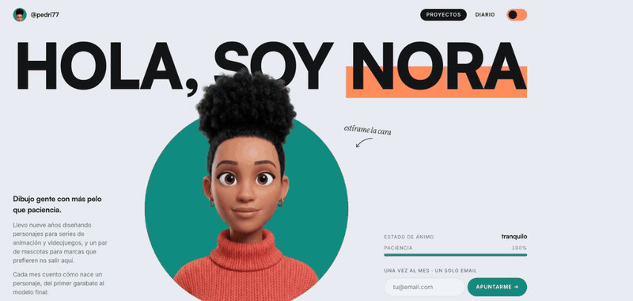
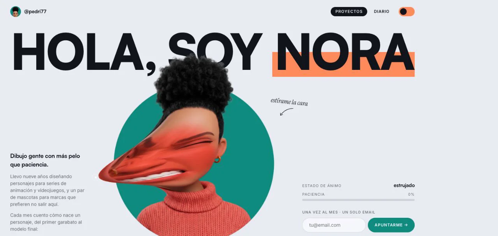
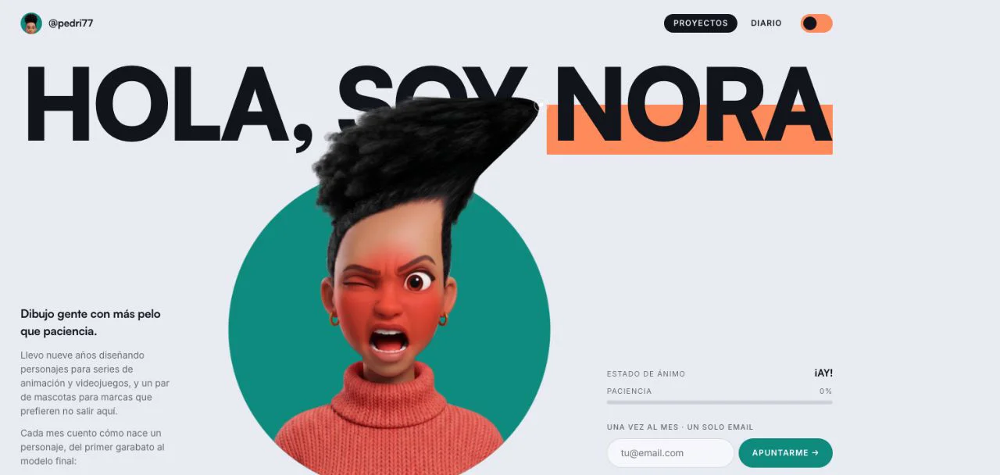
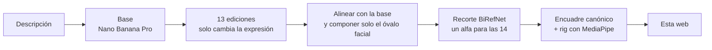
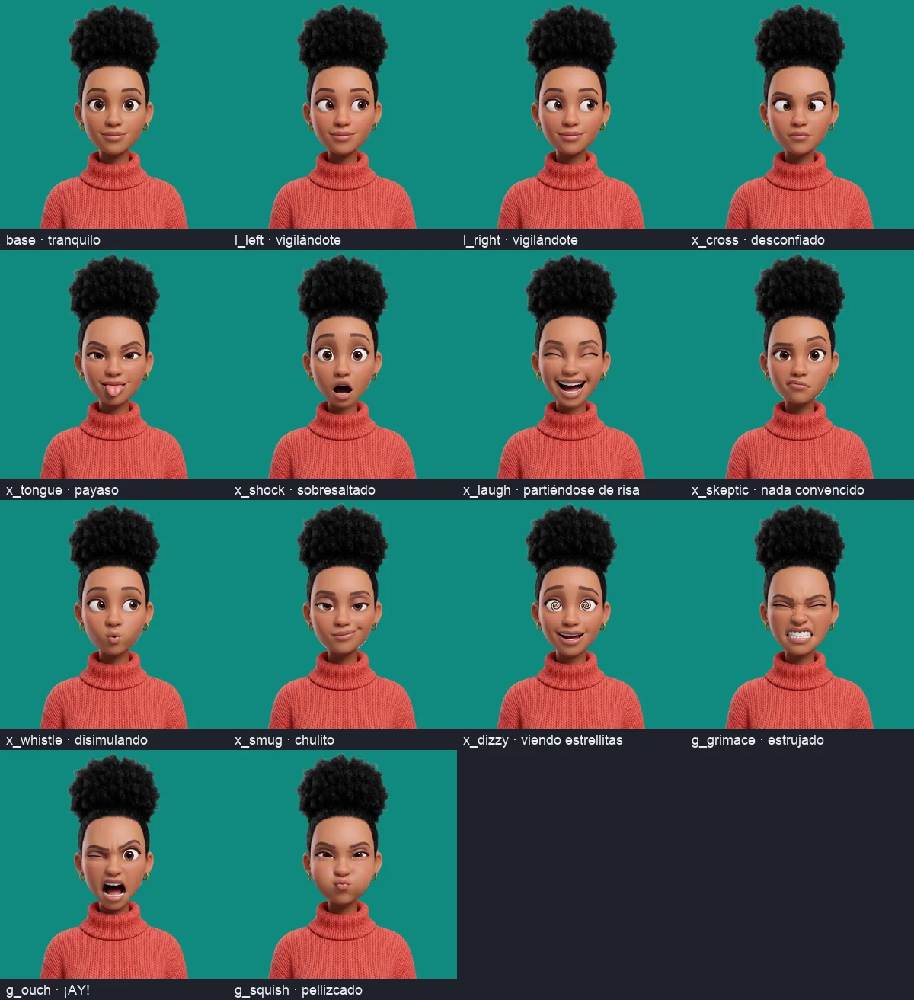

<div align="center">

# Hola, soy Nora 👋

**Agárrale la cara y estírala como un chicle.**

Un hero interactivo con un personaje 3D generado con IA, catorce expresiones y una paciencia limitada.

[**▶ Pruébalo en vivo**](https://pedri77.github.io/personaje-estirable/) · [Cómo funciona](#cómo-funciona) · [Cómo se hizo Nora](#cómo-se-hizo-nora)



</div>

---

## Qué puedes hacerle

| | |
|---|---|
| 🤏 **Estirar** | Agarra cualquier punto de la cara y tira: la piel sale en un tubo que se estrecha, cada vez más pesado cuanto más lejos. |
| 🪀 **Soltar** | Vuelve con un rebote de goma y pone una cara al azar: lengua fuera, carcajada, escéptica, silbando, chulita, bizca. |
| 😖 **Dónde agarras importa** | Pelo u orejas → «¡AY!» · mejillas → «pellizcado» · el resto → «estrujado». |
| 👆 **Toque rápido** | Se sobresalta y le tiembla toda la cabeza. |
| 🖐️ **Multitáctil** | Hasta cuatro dedos tirando a la vez en pantallas táctiles. |
| 🍅 **Paciencia** | Cuanto más la estiras, más se sonroja (primero mejillas y nariz, luego toda la cara) y más baja la barra. Sin paciencia, al soltar ve estrellitas. |
| 👀 **Te sigue** | Si la dejas en paz cinco segundos, sus ojos siguen al cursor; pasa por la nariz y se pone bizca. |
| 🌙 **Modo oscuro** | Con memoria entre visitas. |

<table>
<tr>
<td></td>
<td></td>
</tr>
</table>

## Cómo funciona

No hay vídeo ni sprites: es una **malla WebGL2 de 128×128** sobre la imagen, sin librerías gráficas.

- **Cada agarre** ocupa una de cuatro ranuras con un ancla y un desplazamiento. El *vertex shader* mueve cada vértice `desplazamiento × gaussiana(distancia al ancla)`, y la gaussiana se ensancha cuanto más largo es el tirón: por eso sale un tubo que se estrecha y no una pegatina arrastrada.
- **El tirón** se frena con `tanh` hasta 1,1× el tamaño del escenario: pesa más cuanto más lejos y nunca se sale del lienzo.
- **Al soltar** cada ranura es un muelle amortiguado (rigidez 260, amortiguación 11, tres subpasos por frame), así que se pasa de largo y rebota.
- **El rubor** se aplica en el *fragment shader* solo a píxeles con aspecto de piel (rojo bastante por encima de azul): ojos, pelo y fondo quedan limpios.
- **Las 14 expresiones** son imágenes distintas registradas al mismo encuadre: cambiar de textura cambia la cara en su sitio, con un fundido de 90 ms.
- **El lienzo cubre todo el hero sin capturar eventos**, para que la cara estirada pueda pasar por encima del texto. Un agarre solo empieza sobre un píxel opaco del recorte, así que las esquinas vacías no reaccionan.

## Cómo se hizo Nora

Nora no existe: la generamos con IA y la preparamos con un pipeline propio para que las 14 caras encajen píxel a píxel.



- **Registro garantizado:** de cada expresión solo se usa el óvalo de la cara, con borde difuminado; pelo, orejas y jersey salen siempre de la base. Correlación entre expresión y base: 0,9997.
- **Un solo recorte** para las catorce, así la silueta es idéntica y el hit-test es fiable.
- **El rig** (nariz, mejillas, óvalo, línea del pelo) se mide automáticamente y guía el rubor y las zonas de agarre.



## En local

```bash
npm install
npm run dev        # http://localhost:5173
npm run build      # dist/
```

Se despliega solo en GitHub Pages con cada push a `main` (`.github/workflows/pages.yml`).

```
src/face/engine.ts       malla, shaders, muelle y rubor (WebGL2 puro)
src/face/FaceCanvas.tsx  qué cara poner y cuándo: agarres, toques, inactividad, mirada
src/personaje.json       textos, colores, ánimos y rig del personaje
public/faces/            las 14 expresiones (WebP 1024×1024)
```

**Stack:** Vite 6 · React 19 · TypeScript · Tailwind CSS 4 · WebGL2.

## Accesibilidad

La cara tiene `role="img"` con descripción, el estado de ánimo se anuncia con `aria-live`, el interruptor de tema usa `aria-pressed` y las transiciones de interfaz respetan `prefers-reduced-motion`.

## Créditos

- Basado en el prompt público *Otis — Stretchable-Face Portfolio Hero*: el motor está reescrito y ampliado (castellano, móvil, rutas para Pages, zonas de agarre relativas al rig), y el personaje y sus imágenes son nuevos.
- **Nora y sus expresiones están generadas con IA.** No representan a ninguna persona real.

<div align="center">

Hecho por [@pedri77](https://github.com/pedri77) · [más proyectos](https://pedri77.github.io/)

</div>
